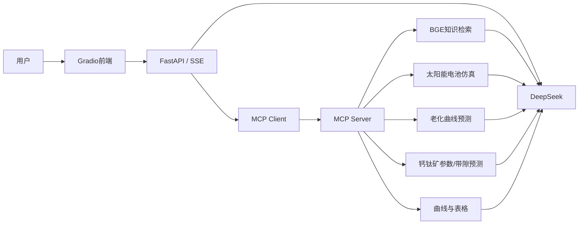

# SolarAI-X

基于 **DeepSeek + MCP + RAG + FastAPI + Gradio** 的太阳能与钙钛矿领域智能分析Agent。用户可以用自然语言查询领域知识、调用太阳能电池仿真工具、生成曲线和表格，并完成钙钛矿参数、老化曲线和材料带隙预测。

项目的核心不是单次大模型问答，而是让大模型通过MCP动态发现并调用领域工具：

```text
用户问题
→ DeepSeek判断是否需要工具
→ MCP发现并执行领域工具
→ RAG检索 / 仿真 / 预测 / 可视化
→ 工具结果返回DeepSeek
→ 生成带依据和图表的最终回答
```

## 核心功能

- DeepSeek Chat与Reasoner流式对话；
- MCP工具发现、参数生成、工具执行与结果回传；
- 基于BGE Embedding的太阳能领域知识检索；
- 硅太阳能电池单次与批量参数仿真；
- 钙钛矿窄/宽带隙器件参数预测；
- 钙钛矿老化曲线预测；
- MAPbIBr、CsMAFAPbIBr、MAFA和CsFA材料带隙预测；
- 曲线和数据表格生成；
- FastAPI REST/SSE接口和Swagger文档；
- Gradio五功能页面；
- 模型缺失时的降级启动和能力状态检查；
- 不调用真实大模型的项目结构自动测试。

## 系统架构



更详细的调用过程见[架构说明](docs/ARCHITECTURE.md)。

## MCP工具

| 工具 | 作用 |
|---|---|
| `draw_curve` | 根据数据绘制曲线 |
| `draw_table` | 将结构化数据绘制成表格 |
| `simulate_solar_cell` | 单组硅太阳能电池参数仿真 |
| `batch_simulate_solar_cell` | 扫描指定参数并对比性能趋势 |
| `search_embedded_text` | 检索太阳能领域本地知识库 |
| `process_directory_for_embedding` | 将文本目录构建为Embedding知识库 |
| `predict_perovskite_aging` | 预测钙钛矿器件老化曲线 |
| `predict_perovskite_parameters` | 预测窄/宽带隙钙钛矿器件参数 |
| `predict_perovskite_bandgap` | 预测不同组成钙钛矿材料带隙 |

## 功能可用性

项目支持“部分模型未配置时降级启动”，不会因为某一个模型目录缺失导致整个服务无法运行。

| 功能 | 所需配置 |
|---|---|
| 健康检查、Swagger、带隙预测 | 安装基础依赖即可 |
| DeepSeek聊天 | `.env`配置`DEEPSEEK_API_KEY` |
| MCP连接和通用绘图 | 启动MCP服务 |
| 老化曲线预测 | 仓库内`quxian_high500.pth`与Excel数据 |
| RAG检索 | 安装`FlagEmbedding`并准备`embedding/` |
| 硅电池参数预测 | 配置`MODEL_DIR`指向完整AutoGluon模型 |
| 钙钛矿器件参数预测 | 配置`PSKNA_DIR`、`PSKWD_DIR` |

可以访问下面的接口确认实际能力状态：

```text
GET http://127.0.0.1:8001/api/health
```

返回内容会显示：

- DeepSeek是否配置；
- MCP是否连接；
- 三组AutoGluon模型是否可用；
- 缺失模型的具体目录和原因。

## 项目结构

```text
solarAI-X/
├── api/
│   ├── main.py              # FastAPI、流式对话和业务接口
│   ├── mcpserver.py         # MCP Server和9个领域工具
│   ├── embed.py             # Embedding生成、保存和检索
│   ├── mlutil.py            # AutoGluon参数预测
│   ├── aging_utils.py       # PyTorch老化曲线预测
│   ├── quxian_high500.pth   # 老化预测模型
│   └── quxian_shiyan.xlsx   # 归一化参考数据
├── web/
│   ├── app.py               # Gradio入口
│   ├── api/                 # 前端API交互层
│   └── ui/                  # 五个业务页面
├── embedding/               # 已生成的知识向量和来源信息
├── models/                  # 外部AutoGluon模型放置说明
├── tests/                   # 无外部服务依赖的自动测试
├── docs/                    # 架构、演示和简历材料
├── .env.example
├── requirements.txt
├── requirements-ml.txt
├── setup.bat
├── run_mcp.bat
├── run_api.bat
├── run_ui.bat
└── run_all.bat
```

## Windows快速开始

推荐Python 3.11或3.12。

### 1. 安装基础环境

双击：

```text
setup.bat
```

或者在PowerShell运行：

```powershell
cd solarAI-X
py -3.12 -m venv .venv
.\.venv\Scripts\python.exe -m pip install -r requirements.txt -r requirements-dev.txt
Copy-Item .env.example .env
```

基础环境支持聊天、MCP、老化预测、带隙预测和Gradio页面。完整RAG与AutoGluon功能继续安装：

```text
setup_full_ml.bat
```

或者：

```powershell
.\.venv\Scripts\python.exe -m pip install -r requirements-ml.txt
```

### 2. 配置本地环境变量

编辑`.env`：

```dotenv
DEEPSEEK_API_KEY=填写你自己的Key
MCP_SERVER_URL=http://127.0.0.1:12346/sse
SOLAR_API_HOST=127.0.0.1
SOLAR_API_PORT=8001
SOLAR_API_BASE_URL=http://127.0.0.1:8001/api
SOLAR_UI_HOST=127.0.0.1
SOLAR_UI_PORT=5173
EMBEDDING_DIR=embedding
MODEL_DIR=models/solar
PSKNA_DIR=models/perovskite_narrow
PSKWD_DIR=models/perovskite_wide
```

真实Key只保存在`.env`，不要提交到Git。

AutoGluon模型目录要求见[模型目录说明](models/README.md)。

### 3. 启动三个服务

最简单的方式是双击：

```text
run_all.bat
```

也可以依次打开三个PowerShell窗口：

```powershell
.\run_mcp.bat
.\run_api.bat
.\run_ui.bat
```

启动顺序：

```text
MCP Server → FastAPI → Gradio
```

访问地址：

| 服务 | 地址 |
|---|---|
| Gradio页面 | <http://127.0.0.1:5173> |
| FastAPI文档 | <http://127.0.0.1:8001/docs> |
| 健康检查 | <http://127.0.0.1:8001/api/health> |
| MCP SSE | <http://127.0.0.1:12346/sse> |

## 演示顺序

推荐按下面顺序向面试官展示：

1. 打开`/api/health`，展示LLM、MCP和模型能力状态；
2. 在AI对话页面询问一个太阳能领域问题，展示RAG引用；
3. 用自然语言要求Agent调用`simulate_solar_cell`并生成JV曲线；
4. 展示钙钛矿老化预测页面；
5. 展示钙钛矿带隙预测；
6. 打开FastAPI Swagger和MCP工具代码解释完整调用链。

完整讲解见[面试与简历指南](docs/RESUME_GUIDE.md)和[演示脚本](docs/DEMO_SCRIPT.md)。

## 测试

运行：

```powershell
.\.venv\Scripts\python.exe -m pytest
```

当前自动测试不连接DeepSeek、不启动MCP，也不消耗API额度，主要验证：

- 所有Python文件语法；
- FastAPI关键接口契约；
- MCP九个工具注册契约；
- 配置模板完整性；
- 老化模型和Embedding资产是否存在；
- README与实际Gradio架构是否一致；
- Gradio页面是否能在不启动服务的情况下成功构建，并且没有版本弃用警告。

原项目中的在线联调脚本可在服务启动后作为人工端到端测试使用。

## 当前边界

- 对话历史目前保存在内存中，服务器重启后消失；
- AutoGluon模型未随维护版直接分发，需要通过`.env`配置本地模型目录；
- RAG首次运行需要加载BGE模型，可能产生模型下载；
- 预测结果只在训练数据适用范围内有意义，不能替代真实实验验证；
- 当前自动测试以项目契约测试为主，后续可增加Fake LLM和FastAPI集成测试。

## 技术栈

`Python / DeepSeek API / MCP / Tool Calling / RAG / BGE / FastAPI / Gradio / PyTorch / AutoGluon / Pydantic / SSE / pytest`

## License

MIT
