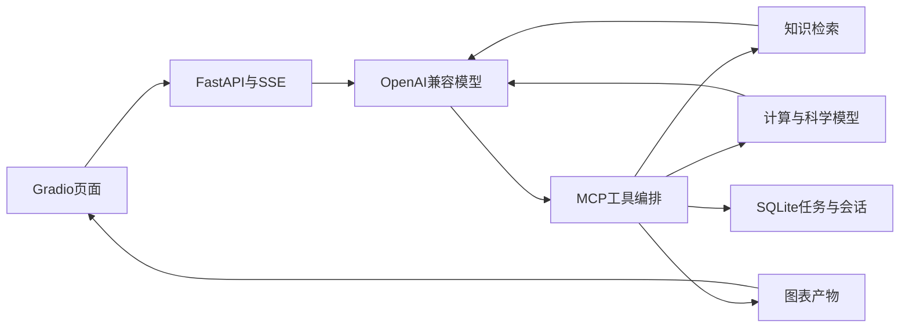

# SolarAI-X

太阳能与钙钛矿领域工具应用：自然语言提问经OpenAI兼容模型与MCP编排，完成知识检索、带隙计算、仿真/预测及绘图，保存任务过程与生成结果。

- 9个MCP工具、5类Gradio业务页面、FastAPI/SSE流式交互。
- 异步模型流；工具白名单、Schema校验、超时和只读检索有限重试。
- SQLite任务与会话、取消和重启恢复；标准/旧版MCP错误均明确记录。
- 生成结果目录与下载权限一致；PNG结构、校验和及像素解码共同验证。



## 快速开始

Python 3.12。在项目根目录安装基础依赖：

```powershell
py -3.12 -m venv .venv
.\.venv\Scripts\python.exe -m pip install --index-url https://download.pytorch.org/whl/cpu "torch>=2.3,<3.0"
.\.venv\Scripts\python.exe -m pip install -r requirements.txt -r requirements-dev.txt
Copy-Item .env.example .env
```

按 `.env.example` 配置自己的模型服务，再分别运行 `run_mcp.bat`、`run_api.bat`、`run_ui.bat`。
打开 [API健康状态](http://127.0.0.1:8001/api/health)、[接口文档](http://127.0.0.1:8001/docs)、[Gradio页面](http://127.0.0.1:5173)。已有 `.env` 时直接保留原配置。

## 固定演示与真实验证

无需模型密钥的离线演示：

```powershell
.\.venv\Scripts\python.exe scripts/run_offline_demo.py
```

此模式使用脚本模型和真实本地工具，不代表模型自主决策质量。另有 [三分钟演示步骤](docs/SHOWCASE.md)、[真实任务摘要](docs/examples/real-task-summary.json) 和 [实际生成曲线](docs/examples/bandgap-curve.png)。

已启动MCP并配置模型后，可手动执行以下真实任务评测（会消耗额度）：

```powershell
.\.venv\Scripts\python.exe scripts/evaluate_agent_live.py --live --max-cases 2
```

## 验证与边界

历史验证：2026-10-19早期本地Windows回归156项通过；2026-10-18的2条真实模型与SSE MCP固定任务通过，并用v3图片校验复评。数量不代表通用准确率、科学预测精度或生产吞吐。

本轮扩展评测：40道独立任务首轮32/40、含重复46/56严格验收通过；固定8任务中7个三次通过。保留失败并修复标识漏检、错误类别丢失和无效表格数据，修复后Windows本地198项回归及8项实际MCP检查通过，尚未真实模型复测。详见 [扩展验收及限制](docs/EXPANDED_ACCEPTANCE_V6.md)。

BGE语义检索与AutoGluon预测需要额外依赖及模型资产；能力状态接口会报告实际可用情况。关键词降级结果不会称为语义检索。
当前为本机单用户、单API worker演示。另在不含 `.env` 的全新Python 3.12环境完成安装、同样数量的回归与实际启动验证。远程CI仍待公开同步后运行，结果以Pull Request检查为准。

[完整配置与运行参考](docs/REFERENCE.md) · [任务接口与v3说明](docs/JOB_READY_UPGRADE.md) · [详细架构](docs/ARCHITECTURE.md)

带隙功能当前提供 MAPbIBr 原项目线性公式演示；CsMAFAPbIBr、MAFA、CsFA 缺少可核验训练资料，暂不可预测。详见 [v4科学模型契约修复](docs/SCIENTIFIC_MODEL_V4.md)。

新增公开光谱文献训练的带隙基线、严格留出评估与12任务验证工具；详见 [v5改进](docs/PUBLIC_BASELINE_V5.md)。三个低样本材料家族仍未开放。新12任务真实效果待运行。


### 真实模型验收（固定12任务）

使用 qwen-plus 与真实本地MCP工具，12道固定任务12道通过（8正向、4负向），新增23次聊天、0次Embedding；覆盖公式/公开测量基线、绘图、越界与不可用状态。持久工具事件离线重评分仍为12/12。此结果限于这组作者编写任务，不代表通用Agent准确率或并发生产验证。见 [完整验收及限制](docs/REAL_AGENT_ACCEPTANCE_V5.md)。

本轮可靠性修复：将计算结果引用绑定到实际绘图数据，最终回答在产物路径核对通过后输出；5个真实本地MCP场景通过。 最新Windows本地完整回归224项通过，未追加付费模型复测。实现与限制见 [可靠性修复说明](docs/RELIABILITY_V9.md)，远程验证以本次PR的Windows/Ubuntu检查结果为准。
