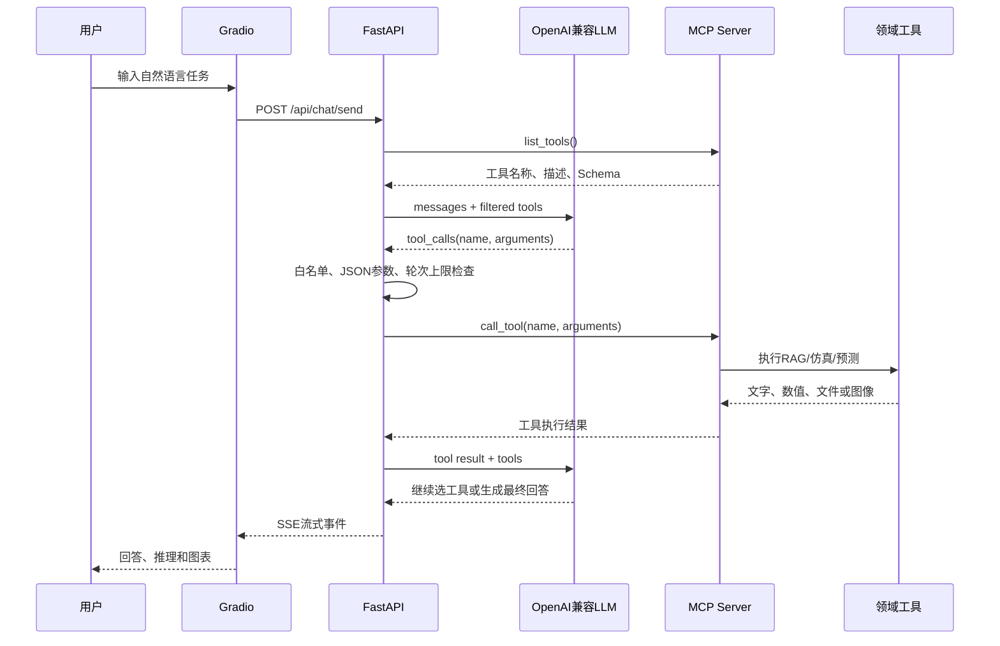

# SolarAI-X架构说明

## 1. 服务关系

SolarAI-X由三个独立进程组成：

```text
Gradio UI（5173）
        ↓ HTTP / SSE
FastAPI（8001）
        ↓ MCP SSE
MCP Server（12346）
        ↓
RAG、仿真、预测、绘图工具
```

拆成三个进程的原因是：

- 页面、业务API和工具服务职责分离；
- MCP Server可以被其他MCP Client复用；
- 模型工具失败时不必让前端直接处理模型细节；
- 后续可以单独部署和扩缩容。

## 2. Agent工具调用流程



## 3. RAG流程

```text
太阳能领域文档
→ 段落感知重叠切片
→ TextEmbedding.process_directory
→ embeddings.pkl + file_info.pkl
→ search_embedded_text
→ 优先使用BGE向量候选 + 词法重排序
→ BGE不可用时切换为透明的关键词覆盖检索
→ Top-N片段、来源和分块编号
→ LLM生成回答
```

当前知识片段和向量保存在本地文件中，适合教学和演示。`RAG_BACKEND=auto`会优先选择语义检索，并把实际后端写入健康检查和工具结果。数据规模扩大后可以替换为FAISS、Qdrant、Milvus或pgvector。

## 4. 工具执行边界

- MCP发现的工具还要经过可选白名单过滤，未注册或未授权的名称不能执行；
- 流式工具参数必须是合法JSON，否则向模型返回结构化错误而不调用工具；
- Agent可根据上一步工具结果继续选择工具，但最多执行配置的轮次，防止循环；
- 每次调用设置超时。只读检索工具可有限重试，仿真、绘图和知识库写入工具不自动重试；
- 日志记录工具名、尝试次数、结果和错误类型，不写API Key。

## 5. 模型降级设计

SolarAI-X包含多组彼此独立的模型。如果在模块导入时强制要求所有模型存在，那么缺少一个外部目录就会导致整个API无法启动。

维护版改为：

```text
服务启动
→ 尝试加载各模型组
→ 记录每组模型的available/error状态
→ 其他功能继续启动
→ 调用缺失模型时返回清晰的503错误
→ 前端禁用对应预测按钮并显示缺失项
```

`GET /api/health`用于查看当前实际能力，而不是只返回一个无法解释的`ok`。

## 6. 数据生命周期

| 数据 | 当前存储 | 生命周期 |
|---|---|---|
| 对话消息 | Python内存字典 | FastAPI重启后消失 |
| Embedding | 本地PKL文件 | 持久保存 |
| AutoGluon模型 | 外部模型目录 | 持久保存 |
| 老化模型 | 项目内PTH文件 | 持久保存 |
| 生成图表 | `outputs/` | 手动清理 |

后续可以使用SQLite或PostgreSQL持久化对话，并为图表增加定期清理策略。
