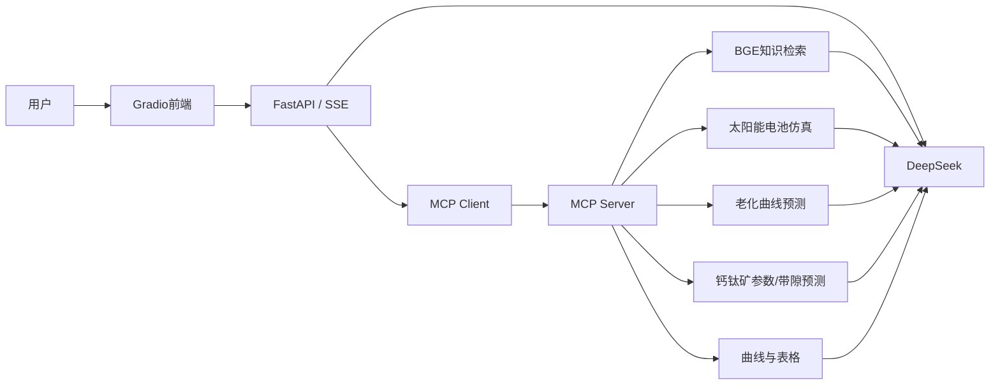

# SolarAI-X

基于 **DeepSeek + MCP + RAG + FastAPI + Gradio** 的太阳能与钙钛矿领域智能分析Agent。用户可以用自然语言查询领域知识、调用太阳能电池仿真工具、生成曲线和表格，并完成钙钛矿参数、老化曲线和材料带隙预测。

项目的核心不是单次大模型问答，而是让大模型通过MCP动态发现并调用领域工具：

```text
用户问题
→ DeepSeek判断是否需要工具
→ MCP发现并执行领域工具
→ RAG检索 / 仿真 / 预测 / 可视化
→ 工具结果返回DeepSeek
→ 生成带依据和图表的最终回答
```

## 核心功能

- DeepSeek Chat与Reasoner流式对话；
- MCP工具发现、参数生成、多轮自主工具选择与结果回传，并设置工具白名单和最大调用轮次；
- 基于BGE Embedding的太阳能领域知识检索，加入段落感知重叠切片、候选去重和词法/向量混合重排序；未安装BGE时自动降级为带来源的关键词检索；
- 硅太阳能电池单次与批量参数仿真；
- 钙钛矿窄/宽带隙器件参数预测；
- 钙钛矿老化曲线预测；
- MAPbIBr 带隙线性公式演示；CsMAFAPbIBr、MAFA、CsFA 的历史模型缺少训练与验证资料，暂不可用；
- 曲线和数据表格生成；
- FastAPI REST/SSE接口和Swagger文档；
- Gradio五功能页面；
- 模型缺失时的降级启动和能力状态检查；
- MCP调用超时与结构化日志；只读检索工具支持有限指数退避重试，副作用工具禁止自动重试；
- 不调用真实大模型的项目契约、Agent 工具编排与错误边界自动测试；
- 基于现有手册的 24 题检索评测，固定开发/测试分组，对照原切片与 600/80 重切片；
- 真实本地检索和带隙计算的五场景离线演示，一键生成日志、逐题结果及源码指纹。

## 系统架构



更详细的调用过程见[架构说明](docs/ARCHITECTURE.md)。

## MCP工具

| 工具 | 作用 |
|---|---|
| `draw_curve` | 根据数据绘制曲线 |
| `draw_table` | 将结构化数据绘制成表格 |
| `simulate_solar_cell` | 单组硅太阳能电池参数仿真 |
| `batch_simulate_solar_cell` | 扫描指定参数并对比性能趋势 |
| `search_embedded_text` | 检索太阳能领域本地知识库 |
| `process_directory_for_embedding` | 将文本目录构建为Embedding知识库 |
| `predict_perovskite_aging` | 预测钙钛矿器件老化曲线 |
| `predict_perovskite_parameters` | 预测窄/宽带隙钙钛矿器件参数 |
| `predict_perovskite_bandgap` | MAPbIBr 公式计算；其他三类带隙模型明确返回不可用 |

## 功能可用性

项目支持“部分模型未配置时降级启动”，不会因为某一个模型目录缺失导致整个服务无法运行。

| 功能 | 所需配置 |
|---|---|
| 健康检查、Swagger、带隙预测 | 安装基础依赖即可 |
| DeepSeek或豆包聊天 | `.env`配置OpenAI兼容的API地址、Key和模型ID |
| MCP连接和通用绘图 | 启动MCP服务 |
| 老化曲线预测 | 仓库内`quxian_high500.pth`与Excel数据 |
| RAG检索 | 准备`embedding/`即可使用关键词检索；语义模式还需要`FlagEmbedding`、BGE模型与匹配的有效向量索引 |
| 硅电池参数预测 | 配置`MODEL_DIR`指向完整AutoGluon模型 |
| 钙钛矿器件参数预测 | 配置`PSKNA_DIR`、`PSKWD_DIR` |

可以访问下面的接口确认实际能力状态：

```text
GET http://127.0.0.1:8001/api/health
```

返回内容会显示：

- DeepSeek是否配置；
- MCP是否连接；
- RAG当前使用`semantic`还是`lexical`后端；
- 三组AutoGluon模型是否可用；
- 缺失模型的具体目录和原因。

## 项目结构

```text
solarAI-X/
├── api/
│   ├── main.py              # FastAPI、流式对话和业务接口
│   ├── mcpserver.py         # MCP Server和9个领域工具
│   ├── embed.py             # Embedding生成、保存和检索
│   ├── mlutil.py            # AutoGluon参数预测
│   ├── aging_utils.py       # PyTorch老化曲线预测
│   ├── quxian_high500.pth   # 老化预测模型
│   └── quxian_shiyan.xlsx   # 归一化参考数据
├── web/
│   ├── app.py               # Gradio入口
│   ├── api/                 # 前端API交互层
│   └── ui/                  # 五个业务页面
├── embedding/               # 已生成的知识向量和来源信息
├── models/                  # 外部AutoGluon模型放置说明
├── tests/                   # 无外部服务依赖的自动测试
├── docs/                    # 架构、演示和简历材料
├── .env.example
├── requirements.txt
├── requirements-ml.txt
├── setup.bat
├── run_mcp.bat
├── run_api.bat
├── run_ui.bat
└── run_all.bat
```

## Windows快速开始

推荐Python 3.11或3.12。

### 1. 安装基础环境

双击：

```text
setup.bat
```

或者在PowerShell运行：

```powershell
cd solarAI-X
py -3.12 -m venv .venv
.\.venv\Scripts\python.exe -m pip install -r requirements.txt -r requirements-dev.txt
Copy-Item .env.example .env
```

基础环境支持聊天、MCP、RAG关键词检索、老化预测、带隙预测和Gradio页面。BGE语义检索与AutoGluon功能继续安装：

```text
setup_full_ml.bat
```

或者：

```powershell
.\.venv\Scripts\python.exe -m pip install -r requirements-ml.txt
```

### 2. 配置本地环境变量

编辑`.env`：

```dotenv
DEEPSEEK_API_KEY=填写你自己的Key
LLM_PROVIDER=deepseek
LLM_API_KEY=
LLM_BASE_URL=
LLM_DEFAULT_MODEL=deepseek-chat
MCP_SERVER_URL=http://127.0.0.1:12346/sse
SOLAR_API_HOST=127.0.0.1
SOLAR_API_PORT=8001
SOLAR_API_BASE_URL=http://127.0.0.1:8001/api
SOLAR_UI_HOST=127.0.0.1
SOLAR_UI_PORT=5173
EMBEDDING_DIR=embedding
RAG_BACKEND=auto
RAG_LEXICAL_MIN_SCORE=0.05
RAG_CHUNK_CHARACTERS=600
RAG_CHUNK_OVERLAP=80
RAG_DENSE_WEIGHT=0.8
MCP_TOOL_TIMEOUT_SECONDS=30
MCP_TOOL_MAX_ATTEMPTS=3
MCP_TOOL_ALLOWLIST=
MAX_TOOL_ROUNDS=4
MODEL_DIR=models/solar
PSKNA_DIR=models/perovskite_narrow
PSKWD_DIR=models/perovskite_wide
```

真实Key只保存在`.env`，不要提交到Git。

通用的`LLM_*`配置优先于兼容保留的`DEEPSEEK_*`配置。接入豆包方舟时可使用：

```dotenv
LLM_PROVIDER=doubao
LLM_API_KEY=填写方舟API Key
LLM_BASE_URL=https://ark.cn-beijing.volces.com/api/v3
LLM_DEFAULT_MODEL=填写方舟推理接入点ID
LLM_MODEL_NAME=豆包模型
```

接入阿里云百炼时可使用：

```dotenv
LLM_PROVIDER=aliyun-bailian
LLM_API_KEY=填写百炼API Key
LLM_BASE_URL=https://dashscope.aliyuncs.com/compatible-mode/v1
LLM_DEFAULT_MODEL=qwen-plus
LLM_MODEL_NAME=通义千问 Plus
```

`RAG_BACKEND=auto`会优先使用BGE语义检索；没有安装`FlagEmbedding`或模型加载失败时，自动改用本地关键词检索，并在健康检查和工具结果中明确标记。若知识库是在关键词模式生成的（没有有效向量），安装依赖不等于完成语义索引；需要重新生成向量。显式 `semantic` 模式遇到这类索引会报错，`auto` 会保持关键词降级，不会假装语义检索已就绪。

AutoGluon模型目录要求见[模型目录说明](models/README.md)。

### 3. 启动三个服务

最简单的方式是双击：

```text
run_all.bat
```

也可以依次打开三个PowerShell窗口：

```powershell
.\run_mcp.bat
.\run_api.bat
.\run_ui.bat
```

启动顺序：

```text
MCP Server → FastAPI → Gradio
```

访问地址：

| 服务 | 地址 |
|---|---|
| Gradio页面 | <http://127.0.0.1:5173> |
| FastAPI文档 | <http://127.0.0.1:8001/docs> |
| 健康检查 | <http://127.0.0.1:8001/api/health> |
| MCP SSE | <http://127.0.0.1:12346/sse> |

## 演示顺序

推荐按下面顺序向面试官展示：

1. 打开`/api/health`，展示LLM、MCP和模型能力状态；
2. 在AI对话页面询问一个太阳能领域问题，展示RAG引用；
3. 用自然语言要求Agent调用`simulate_solar_cell`并生成JV曲线；
4. 展示钙钛矿老化预测页面；
5. 展示钙钛矿带隙预测；
6. 打开FastAPI Swagger和MCP工具代码解释完整调用链。

完整讲解见[面试与简历指南](docs/RESUME_GUIDE.md)和[演示脚本](docs/DEMO_SCRIPT.md)。

## 测试

运行：

```powershell
.\.venv\Scripts\python.exe -m pytest
```

当前自动测试不连接DeepSeek、不启动MCP，也不消耗API额度，主要验证：

- 所有Python文件语法；
- FastAPI关键接口契约；
- MCP九个工具注册契约；
- RAG 重叠切片、混合重排序和重复片段过滤；
- MCP 工具白名单、发现的 JSON Schema 参数校验、超时，以及只读/副作用工具不同的重试策略；
- 分片工具参数拼接、非法参数拒绝、调用轮次限制、检测到断连后的停止和多轮上下文更新；
- 生成文件下载路径限制，防止越界访问工程配置或其他文件；
- 配置模板完整性；
- 老化模型和Embedding资产是否存在；
- README与实际Gradio架构是否一致；
- Gradio页面是否能在不启动服务的情况下成功构建，并且没有版本弃用警告。

原项目中的在线联调脚本可在服务启动后作为人工端到端测试使用。

### 一键生成面试证据（不需要 API Key）

从项目根目录运行，不要在 `api/` 子目录执行：

```powershell
Set-Location 'C:\Users\dcc\Documents\ChatGPT\agent\solarAI-X'
.\.venv\Scripts\python.exe -B scripts/collect_interview_evidence.py
```

每次创建一个独立的 `outputs/evidence/evidence-<随机ID>/`，包含完整测试日志、依赖检查、检索评测和离线演示。不会覆盖旧证据、修改 `.env`、请求收费模型或改写知识库。

单独执行：

```powershell
.\.venv\Scripts\python.exe -B scripts/evaluate_retrieval.py
.\.venv\Scripts\python.exe -B scripts/run_offline_demo.py
```

默认只运行关键词后端；语义评测须额外安装依赖并显式传入 `--backend semantic --allow-model-load`，可能加载/下载模型。本轮离线证据不包含 BGE 实测。

评测从仓库既有、可信的 `file_info.pkl` 读取完整原文。不要将外部来源不明的 PKL 当作知识库上传，pickle 反序列化不是安全的文件解析方式。

离线演示调用真实检索和带隙函数，模型请求采用脚本预设，只证明工具链路和错误边界可复现，不证明真实模型选工具的成功率，也不覆盖 MCP SSE 网络传输。检索报告只评价来源/证据命中，不能写成“回答准确率”。

详见 [验证与面试演示说明](docs/interview-evidence.md)、[项目内容建议稿](docs/resume-project-suggestion.md)。

## 当前边界

- 聊天接口的会话和任务记录保存在本地 SQLite，重启后可恢复；
- AutoGluon模型未随维护版直接分发，需要通过`.env`配置本地模型目录；
- 语义模式首次运行需要加载BGE模型，可能产生模型下载；关键词模式完全离线；
- `MCP_TOOL_ALLOWLIST`为空时允许服务发现到的全部工具；生产环境应显式配置允许列表；
- 预测结果只在训练数据适用范围内有意义，不能替代真实实验验证；
- 已覆盖脚本模型的多轮工具编排与部分 FastAPI 路由；尚未验证真实模型决策质量、真实 MCP SSE 传输与高并发运行。
- 英文手册的 PDF 提取噪声、目录片段和跨语言查询仍影响检索效果；切小片段不保证指标提升，应查看固定测试组结果后再决定是否重建线上索引。

## 技术栈

`Python / DeepSeek API / MCP / Tool Calling / RAG / BGE / FastAPI / Gradio / PyTorch / AutoGluon / Pydantic / SSE / pytest`

## License

MIT


## 求职项目升级

异步执行、任务持久化、工具错误判定、参数与结果逐项评测，以及图表下载路径说明见 [本轮升级说明](docs/JOB_READY_UPGRADE.md)。

当前 v3 对生成 PNG 同时检查完整结尾、校验和与像素解码，并将单任务异常隔离为可追溯的失败记录。

带隙能力与验证边界以 [v4科学模型契约说明](SCIENTIFIC_MODEL_V4.md) 为准。MAPbIBr 公式值未经过新增实验精度验证。
